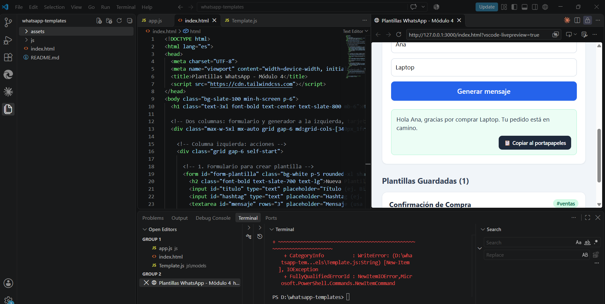

# Gestor de Plantillas para WhatsApp (Laboratorio 13 - Módulo 4)

Aplicación web interactiva desarrollada en JavaScript moderno (ES6+) y Tailwind CSS para crear, organizar y reutilizar plantillas de mensajes de WhatsApp con variables dinámicas (`{nombre}` y `{producto}`)[cite: 14, 15, 18].

## 🚀 Enlace al Proyecto Desplegado
[Ver Gestor de Plantillas en GitHub Pages](https://ericksalazarsanchez-byte.github.io/whatsapp-templates/)

---

## 📸 Evidencia de Funcionamiento ("Usar Plantilla")

---

## 🏗️ Arquitectura y Modelado de Datos (`class Template`)
Para mantener una única fuente de verdad (estado centralizado), cada plantilla se modela como una instancia de la clase **`Template`** (`js/models/Template.js`)[cite: 16, 17]:

* **`constructor(titulo, mensaje, hashtag)`:** Inicializa las propiedades principales de cada plantilla[cite: 17].
* **`this.fecha = new Date()`:** Registra automáticamente el momento exacto en que se crea la plantilla[cite: 17].
* **`obtenerFechaFormateada()`:** Utiliza `.toLocaleDateString('es-PE')` para presentar la fecha en formato legible dentro de cada tarjeta[cite: 17].

---

## 🔤 Métodos de String Implementados
La aplicación manipula y normaliza las cadenas de texto ingresadas por el usuario mediante los siguientes métodos nativos de JavaScript:

* **`.trim()`:** Elimina espacios en blanco innecesarios al inicio y al final de los campos de título, mensaje y variables antes de guardarlos o procesarlos[cite: 16].
* **`.toLowerCase()`:** Normaliza los hashtags a minúsculas para mantener uniformidad visual en las etiquetas[cite: 16].
* **`.startsWith()`:** Verifica si el hashtag ingresado comienza con el símbolo `#`; si no lo tiene, lo antepone automáticamente.
* **`.replaceAll()`:** Sustituye todas las ocurrencias de las variables `{nombre}` y `{producto}` dentro de la plantilla por los valores reales ingresados en el generador.
* **`.slice()`:** Recorta la vista previa de los mensajes que superan los 75 caracteres (`texto.slice(0, 75) + '...'`) para conservar la simetría de la rejilla de tarjetas[cite: 18].
* **`.length`:** Calcula y muestra dinámicamente la cantidad exacta de caracteres de cada plantilla[cite: 18].